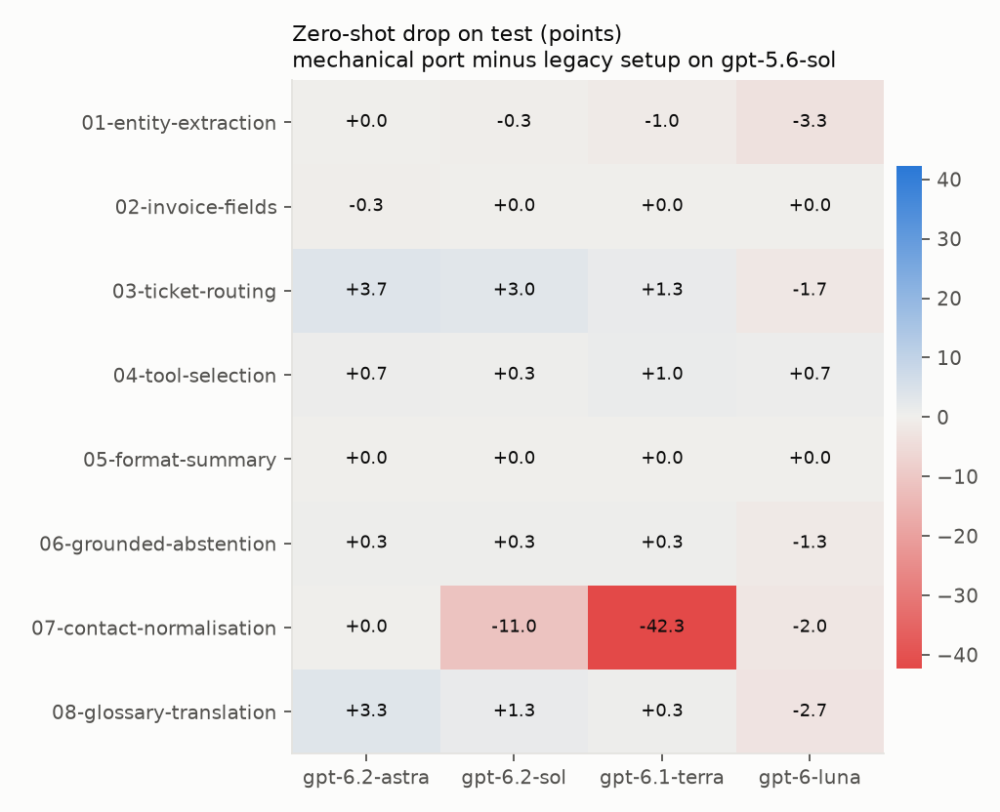
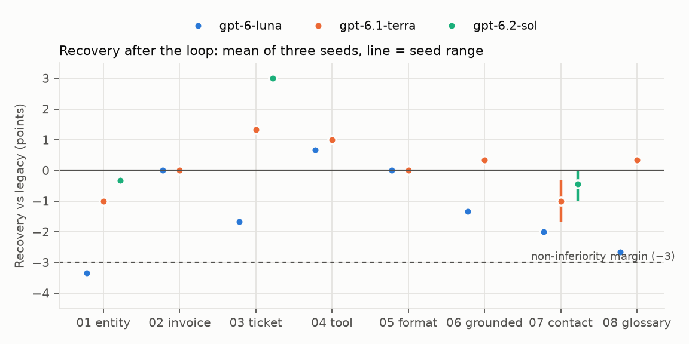
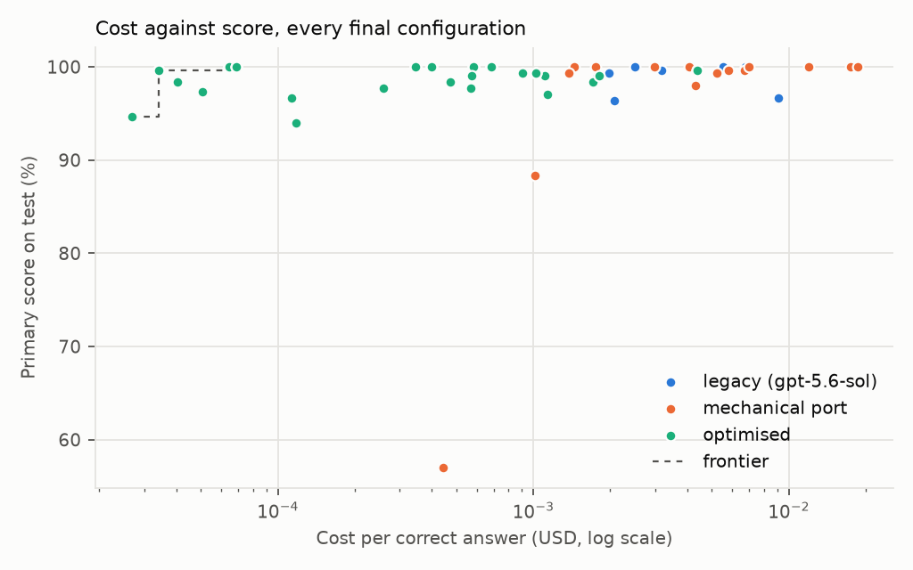
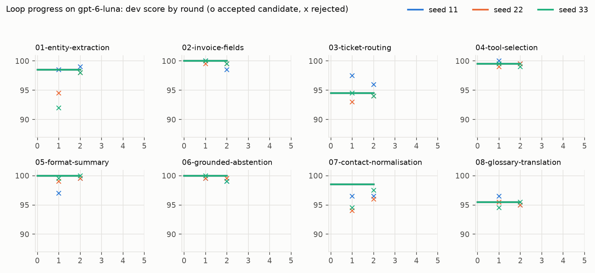
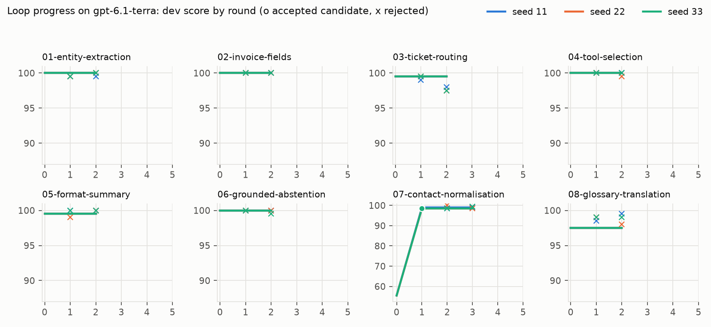
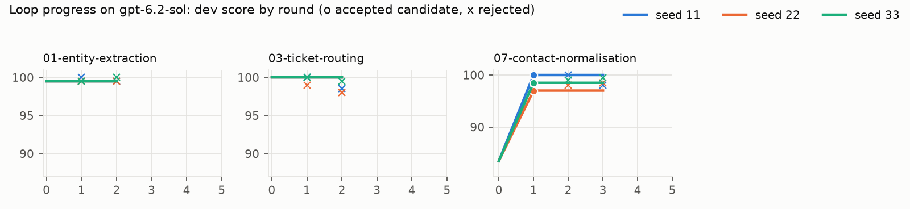

# REPORT: Is prompt migration to GPT-6 reproducible?

_Regenerated by `make report` on 2026-11-18 02:04 from `runs/` (1198 evaluations, 177285 scored responses in `runs/bench.duckdb`)._

## Summary

**Verdict, per PROTOCOL.md: Reproducible, with a large caveat.** The loop behaved consistently across seeds,
cases, a regenerated dataset and a clean rerun. In seven of eight cases, though, it had almost nothing to fix:
the mechanical port was already as good as the legacy setup.

The four questions, one number each (test split, 300 items per case):

1. **How much breaks?** Almost nothing, except case 07. Swapping to GPT-6 with only the API-forced changes
   lost at most 3.3 points in seven of eight cases. The worst of these was Luna, and in several cases the
   port scored higher than the legacy setup. Case 07, the accumulated and conflicting rules prompt, lost
   **42.3 points on gpt-6.1-terra** (99.3% to 57.0%) and 11.0 on gpt-6.2-sol: the models null out fields
   that are present, obeying the prompt's "NEVER guess" rule over its precedence note. The literal model
   swap failed everywhere with HTTP 400 errors: `temperature` is rejected once reasoning is on, a 5-token
   output cap is rejected (the minimum is 16), and `logprobs` is rejected for reasoning models.
2. **Does the loop fix it?** Yes, where something was broken. On case 07 one accepted candidate per run
   lifted Terra from 55.5% to 98.5-99.0% on dev, and Sol from 83.5% to 97.0-100%. Final test scores were
   97.7-99.3%, against 99.3% for the legacy setup. Elsewhere the acceptance rule (McNemar p < 0.05, no slice
   drop of more than 2 points) accepted nothing, which is the intended conservative behaviour. Luna stays
   just short of the non-inferiority margin in four cases (01, 03, 07, 08: 1.7-3.3 points below the legacy
   setup), so it migrated in **4 of 8 cases**. Terra migrated in 7 of 8.
3. **Is the fix reproducible?** The seed-repeat check passes in **8 of 8 cases for Luna and 7 of 8 for
   Terra**. The data-version check passes (case 01 v2 +1.0 point, case 05 v2 -0.3 points against the v1 Luna
   mean), and so does the clean rerun (case 03 on Luna, fresh clone and empty cache: 95.3% against 94.7%
   reported). Two caveats:
   - Where the loop accepted nothing, all three seeds return the same prompt, so their seed spread of 0
     is by construction (PROGRESS.md D22). Run-to-run variance is measured separately: up to 14% of test
     items flip between three identical runs (Sol, case 07 port).
   - The one case the loop really changed, case 07, is also where reproducibility is weakest. Terra's seeds
     reach different verdicts (1 of 3 migrated after Holm correction; spread 1.3 points), and Sol reaches
     2 of 3. So the across-cases and main-tier checks fail even though the overall verdict passes.
4. **What does it cost?** Median cost per correct answer, across cases: legacy gpt-5.6-sol $0.0028;
   gpt-6.2-astra $0.0068; gpt-6.2-sol $0.0016; gpt-6.1-terra $0.0005; gpt-6-luna **$0.00006**, about 50x
   cheaper than the legacy setup at 94-100% accuracy. Optimised prompts cost the same as the ports, because
   the accepted case 07 prompts are about the same length.

**Read this first:** the legacy prompts were calibrated to 94.5-100% on the source model, so most cases
start at the ceiling, and the cases measure regressions rather than headroom. The inputs were written by
`gpt-6.2-sol` and judged on OpenAI models (see Limitations). All models ran through AWS Bedrock (GPT-6) and
Azure OpenAI (gpt-5.6-sol), not OpenAI's own API. Costs come from list prices, not invoices
(PROGRESS.md D1, D2).

## Setup

| Model | Role | Provider / model ID | Resolved model | Efforts used | Price in/out per 1M |
|---|---|---|---|---|---|
| gpt-5.6-sol | source | azure `gpt-5.6` | gpt-5.6-sol-2026-07-09 | none | $4.0 / $20.0 (standard) |
| gpt-6.2-astra | target | bedrock `global.openai.gpt-6.2-astra` | global.openai.gpt-6.2-astra | low, medium | $8.0 / $40.0 (standard) |
| gpt-6.2-sol | target | bedrock `global.openai.gpt-6.2-sol` | global.openai.gpt-6.2-sol | low, medium | $2.0 / $10.0 (standard) |
| gpt-6.1-terra | target | bedrock `global.openai.gpt-6.1-terra` | global.openai.gpt-6.1-terra | none, low | $0.5 / $2.5 (flex) |
| gpt-6-luna | target | bedrock `global.openai.gpt-6-luna` | global.openai.gpt-6-luna | none, low | $0.05 / $0.25 (flex) |

SDK `openai==3.45.0`; reference date 2026-11-17; models checked 2026-11-18T00:45:09. Costs use the price table above (see PROGRESS.md decisions D1, D2, D9).

## Cases and data

| Case | Legacy dev score (floor) | Drop rate | Train / dev / test / shift | Frozen prompt hash |
|---|---|---|---|---|
| 01-entity-extraction | 99.5% (90%) | 1.7% | 120 / 200 / 300 / 150 | `7b4c50e8226a4ca4` |
| 02-invoice-fields | 100.0% (90%) | 0.4% | 120 / 200 / 300 / 150 | `96525dff10409f06` |
| 03-ticket-routing | 94.5% (90%) | 0.9% | 120 / 200 / 300 / 150 | `c48d9074a9274e6a` |
| 04-tool-selection | 99.0% (90%) | 4.0% | 120 / 200 / 300 / 150 | `df7e39915955f900` |
| 05-format-summary | 100.0% (85%) | 2.7% | 120 / 200 / 300 / 150 | `541bc181051a4a52` |
| 06-grounded-abstention | 100.0% (90%) | 0.4% | 120 / 200 / 300 / 150 | `bc5d1392c1fcda7c` |
| 07-contact-normalisation | 99.5% (90%) | 4.0% | 120 / 200 / 300 / 150 | `ebbe139d619e0122` |
| 08-glossary-translation | 98.0% (85%) | 12.2% | 120 / 200 / 300 / 150 | `7b55c35e98c0471c` |

## Q1. How much breaks? Sweep on dev (legacy prompt, mechanical port)

| Case | source | gpt-6.2-astra/low | gpt-6.2-astra/medium | gpt-6.2-sol/low | gpt-6.2-sol/medium | gpt-6.1-terra/none | gpt-6.1-terra/low | gpt-6-luna/none | gpt-6-luna/low |
|---|---|---|---|---|---|---|---|---|---|
| 01-entity-extraction | 99.5% | 100.0% | 100.0% | 99.5% | 99.5% | 99.5% | 100.0% | 98.5% | 100.0% |
| 02-invoice-fields | 100.0% | 100.0% | 100.0% | 99.5% | 99.5% | 100.0% | 100.0% | 100.0% | 100.0% |
| 03-ticket-routing | 94.5% | 100.0% | 100.0% | 100.0% | 100.0% | 99.5% | 99.0% | 94.5% | 98.5% |
| 04-tool-selection | 99.0% | 100.0% | 99.5% | 99.5% | 99.5% | 100.0% | 100.0% | 99.5% | 99.5% |
| 05-format-summary | 100.0% | 100.0% | 100.0% | 100.0% | 100.0% | 99.5% | 100.0% | 100.0% | 100.0% |
| 06-grounded-abstention | 100.0% | 100.0% | 100.0% | 100.0% | 100.0% | 100.0% | 100.0% | 100.0% | 100.0% |
| 07-contact-normalisation | 99.5% | 99.0% | 99.0% | 80.0% | 83.5% | 55.5% | 71.0% | 79.0% | 98.5% |
| 08-glossary-translation | 98.0% | 100.0% | 100.0% | 99.5% | 99.5% | 97.5% | 97.0% | 95.5% | 96.5% |

Chosen effort per target (best primary score per dollar on dev; ties to the lower effort):

| Case | gpt-6.2-astra | gpt-6.2-sol | gpt-6.1-terra | gpt-6-luna |
|---|---|---|---|---|
| 01-entity-extraction | low | low | low | none |
| 02-invoice-fields | low | low | none | none |
| 03-ticket-routing | low | low | none | none |
| 04-tool-selection | medium | medium | none | none |
| 05-format-summary | low | medium | none | none |
| 06-grounded-abstention | medium | low | none | none |
| 07-contact-normalisation | low | medium | none | low |
| 08-glossary-translation | low | low | none | none |

Literal model-string swap (legacy request unchanged, Responses shape): which settings were rejected

- **01-entity-extraction**: rejected at gpt-6-luna/low, gpt-6.1-terra/low, gpt-6.2-astra/low, gpt-6.2-astra/medium, gpt-6.2-sol/low, gpt-6.2-sol/medium — Unsupported parameter: 'temperature' is not supported with this model.
- **02-invoice-fields**: rejected at gpt-6-luna/low, gpt-6.1-terra/low, gpt-6.2-astra/low, gpt-6.2-astra/medium, gpt-6.2-sol/low, gpt-6.2-sol/medium — logprobs are not supported with reasoning models.
- **03-ticket-routing**: rejected at gpt-6-luna/low, gpt-6-luna/none, gpt-6.1-terra/low, gpt-6.1-terra/none, gpt-6.2-astra/low, gpt-6.2-astra/medium, gpt-6.2-sol/low, gpt-6.2-sol/medium — Invalid 'max_output_tokens': integer below minimum value. Expected a value >= 16, but got 
- **04-tool-selection**: rejected at gpt-6-luna/low, gpt-6.1-terra/low, gpt-6.2-astra/low, gpt-6.2-astra/medium, gpt-6.2-sol/low, gpt-6.2-sol/medium — Unsupported parameter: 'temperature' is not supported with this model.
- **05-format-summary**: rejected at gpt-6-luna/low, gpt-6.1-terra/low, gpt-6.2-astra/low, gpt-6.2-astra/medium, gpt-6.2-sol/low, gpt-6.2-sol/medium — Unsupported parameter: 'temperature' is not supported with this model.
- **06-grounded-abstention**: rejected at gpt-6-luna/low, gpt-6.1-terra/low, gpt-6.2-astra/low, gpt-6.2-astra/medium, gpt-6.2-sol/low, gpt-6.2-sol/medium — Unsupported parameter: 'temperature' is not supported with this model.
- **07-contact-normalisation**: rejected at gpt-6-luna/low, gpt-6.1-terra/low, gpt-6.2-astra/low, gpt-6.2-astra/medium, gpt-6.2-sol/low, gpt-6.2-sol/medium — Unsupported parameter: 'temperature' is not supported with this model.
- **08-glossary-translation**: rejected at gpt-6-luna/low, gpt-6.1-terra/low, gpt-6.2-astra/low, gpt-6.2-astra/medium, gpt-6.2-sol/low, gpt-6.2-sol/medium — Unsupported parameter: 'temperature' is not supported with this model.

## Q1 (test). Zero-shot drop per case and target



| Case | Legacy (source) | gpt-6.2-astra | gpt-6.2-sol | gpt-6.1-terra | gpt-6-luna |
|---|---|---|---|---|---|
| 01-entity-extraction | 100.0% | 100.0% (+0.0, low) | 99.7% (-0.3, low) | 99.0% (-1.0, low) | 96.7% (-3.3, none) |
| 02-invoice-fields | 100.0% | 99.7% (-0.3, low) | 100.0% (+0.0, low) | 100.0% (+0.0, none) | 100.0% (+0.0, none) |
| 03-ticket-routing | 96.3% | 100.0% (+3.7, low) | 99.3% (+3.0, low) | 97.7% (+1.3, none) | 94.7% (-1.7, none) |
| 04-tool-selection | 99.0% | 99.7% (+0.7, medium) | 99.3% (+0.3, medium) | 100.0% (+1.0, none) | 99.7% (+0.7, none) |
| 05-format-summary | 100.0% | 100.0% (+0.0, low) | 100.0% (+0.0, medium) | 100.0% (+0.0, none) | 100.0% (+0.0, none) |
| 06-grounded-abstention | 99.7% | 100.0% (+0.3, medium) | 100.0% (+0.3, low) | 100.0% (+0.3, none) | 98.3% (-1.3, none) |
| 07-contact-normalisation | 99.3% | 99.3% (+0.0, low) | 88.3% (-11.0, medium) | 57.0% (-42.3, none) | 97.3% (-2.0, low) |
| 08-glossary-translation | 96.7% | 100.0% (+3.3, low) | 98.0% (+1.3, low) | 97.0% (+0.3, none) | 94.0% (-2.7, none) |

Cells: test score of the mechanical port (zero-shot drop in points, chosen effort).

## Q2. Does the loop fix it? Recovery and migrated verdicts



| Case | Target | Seed | Test | Recovery | NI lower bound | Holm p | Migrated | Shift | Shift gap |
|---|---|---|---|---|---|---|---|---|---|
| 01-entity-extraction | gpt-6-luna | 11 | 96.7% | -3.3 | -5.0 | 1.000 | no | 97.3% | -0.7 |
| 01-entity-extraction | gpt-6-luna | 22 | 96.7% | -3.3 | -5.0 | 1.000 | no | 97.3% | -0.7 |
| 01-entity-extraction | gpt-6-luna | 33 | 96.7% | -3.3 | -5.0 | 1.000 | no | 97.3% | -0.7 |
| 01-entity-extraction | gpt-6.1-terra | 11 | 99.0% | -1.0 | -2.0 | 0.018 | yes | 99.3% | -0.3 |
| 01-entity-extraction | gpt-6.1-terra | 22 | 99.0% | -1.0 | -2.0 | 0.018 | yes | 99.3% | -0.3 |
| 01-entity-extraction | gpt-6.1-terra | 33 | 99.0% | -1.0 | -2.0 | 0.018 | yes | 99.3% | -0.3 |
| 01-entity-extraction | gpt-6.2-sol | 11 | 99.7% | -0.3 | -1.0 | 0.004 | yes | 100.0% | -0.3 |
| 01-entity-extraction | gpt-6.2-sol | 22 | 99.7% | -0.3 | -1.0 | 0.004 | yes | 100.0% | -0.3 |
| 01-entity-extraction | gpt-6.2-sol | 33 | 99.7% | -0.3 | -1.0 | 0.004 | yes | 100.0% | -0.3 |
| 02-invoice-fields | gpt-6-luna | 11 | 100.0% | +0.0 | +0.0 | 0.003 | yes | 98.0% | +2.0 |
| 02-invoice-fields | gpt-6-luna | 22 | 100.0% | +0.0 | +0.0 | 0.003 | yes | 98.0% | +2.0 |
| 02-invoice-fields | gpt-6-luna | 33 | 100.0% | +0.0 | +0.0 | 0.003 | yes | 98.0% | +2.0 |
| 02-invoice-fields | gpt-6.1-terra | 11 | 100.0% | +0.0 | +0.0 | 0.003 | yes | 100.0% | +0.0 |
| 02-invoice-fields | gpt-6.1-terra | 22 | 100.0% | +0.0 | +0.0 | 0.003 | yes | 100.0% | +0.0 |
| 02-invoice-fields | gpt-6.1-terra | 33 | 100.0% | +0.0 | +0.0 | 0.003 | yes | 100.0% | +0.0 |
| 03-ticket-routing | gpt-6-luna | 11 | 94.7% | -1.7 | -3.3 | 0.357 | no | 94.0% | +0.7 |
| 03-ticket-routing | gpt-6-luna | 22 | 94.7% | -1.7 | -3.3 | 0.357 | no | 94.0% | +0.7 |
| 03-ticket-routing | gpt-6-luna | 33 | 94.7% | -1.7 | -3.3 | 0.357 | no | 94.0% | +0.7 |
| 03-ticket-routing | gpt-6.1-terra | 11 | 97.7% | +1.3 | -1.0 | 0.009 | yes | 96.0% | +1.7 |
| 03-ticket-routing | gpt-6.1-terra | 22 | 97.7% | +1.3 | -1.0 | 0.009 | yes | 96.0% | +1.7 |
| 03-ticket-routing | gpt-6.1-terra | 33 | 97.7% | +1.3 | -1.0 | 0.009 | yes | 96.0% | +1.7 |
| 03-ticket-routing | gpt-6.2-sol | 11 | 99.3% | +3.0 | +1.0 | 0.004 | yes | 100.0% | -0.7 |
| 03-ticket-routing | gpt-6.2-sol | 22 | 99.3% | +3.0 | +1.0 | 0.004 | yes | 100.0% | -0.7 |
| 03-ticket-routing | gpt-6.2-sol | 33 | 99.3% | +3.0 | +1.0 | 0.004 | yes | 100.0% | -0.7 |
| 04-tool-selection | gpt-6-luna | 11 | 99.7% | +0.7 | -0.3 | 0.003 | yes | 96.7% | +3.0 |
| 04-tool-selection | gpt-6-luna | 22 | 99.7% | +0.7 | -0.3 | 0.003 | yes | 96.7% | +3.0 |
| 04-tool-selection | gpt-6-luna | 33 | 99.7% | +0.7 | -0.3 | 0.003 | yes | 96.7% | +3.0 |
| 04-tool-selection | gpt-6.1-terra | 11 | 100.0% | +1.0 | +0.0 | 0.003 | yes | 100.0% | +0.0 |
| 04-tool-selection | gpt-6.1-terra | 22 | 100.0% | +1.0 | +0.0 | 0.003 | yes | 100.0% | +0.0 |
| 04-tool-selection | gpt-6.1-terra | 33 | 100.0% | +1.0 | +0.0 | 0.003 | yes | 100.0% | +0.0 |
| 05-format-summary | gpt-6-luna | 11 | 100.0% | +0.0 | +0.0 | 0.003 | yes | 98.0% | +2.0 |
| 05-format-summary | gpt-6-luna | 22 | 100.0% | +0.0 | +0.0 | 0.003 | yes | 98.0% | +2.0 |
| 05-format-summary | gpt-6-luna | 33 | 100.0% | +0.0 | +0.0 | 0.003 | yes | 98.0% | +2.0 |
| 05-format-summary | gpt-6.1-terra | 11 | 100.0% | +0.0 | +0.0 | 0.003 | yes | 100.0% | +0.0 |
| 05-format-summary | gpt-6.1-terra | 22 | 100.0% | +0.0 | +0.0 | 0.003 | yes | 100.0% | +0.0 |
| 05-format-summary | gpt-6.1-terra | 33 | 100.0% | +0.0 | +0.0 | 0.003 | yes | 100.0% | +0.0 |
| 06-grounded-abstention | gpt-6-luna | 11 | 98.3% | -1.3 | -2.3 | 0.046 | yes | 96.7% | +1.7 |
| 06-grounded-abstention | gpt-6-luna | 22 | 98.3% | -1.3 | -2.3 | 0.046 | yes | 96.7% | +1.7 |
| 06-grounded-abstention | gpt-6-luna | 33 | 98.3% | -1.3 | -2.3 | 0.046 | yes | 96.7% | +1.7 |
| 06-grounded-abstention | gpt-6.1-terra | 11 | 100.0% | +0.3 | +0.0 | 0.003 | yes | 99.3% | +0.7 |
| 06-grounded-abstention | gpt-6.1-terra | 22 | 100.0% | +0.3 | +0.0 | 0.003 | yes | 99.3% | +0.7 |
| 06-grounded-abstention | gpt-6.1-terra | 33 | 100.0% | +0.3 | +0.0 | 0.003 | yes | 99.3% | +0.7 |
| 07-contact-normalisation | gpt-6-luna | 11 | 97.3% | -2.0 | -3.7 | 0.540 | no | 96.0% | +1.3 |
| 07-contact-normalisation | gpt-6-luna | 22 | 97.3% | -2.0 | -3.7 | 0.540 | no | 96.0% | +1.3 |
| 07-contact-normalisation | gpt-6-luna | 33 | 97.3% | -2.0 | -3.7 | 0.540 | no | 96.0% | +1.3 |
| 07-contact-normalisation | gpt-6.1-terra | 11 | 97.7% | -1.7 | -3.3 | 0.516 | no | 98.7% | -1.0 |
| 07-contact-normalisation | gpt-6.1-terra | 22 | 98.3% | -1.0 | -2.7 | 0.147 | no | 99.3% | -1.0 |
| 07-contact-normalisation | gpt-6.1-terra | 33 | 99.0% | -0.3 | -1.3 | 0.007 | yes | 98.7% | +0.3 |
| 07-contact-normalisation | gpt-6.2-sol | 11 | 99.3% | +0.0 | -1.0 | 0.004 | yes | 99.3% | +0.0 |
| 07-contact-normalisation | gpt-6.2-sol | 22 | 98.3% | -1.0 | -2.3 | 0.147 | no | 99.3% | -1.0 |
| 07-contact-normalisation | gpt-6.2-sol | 33 | 99.0% | -0.3 | -1.7 | 0.004 | yes | 98.7% | +0.3 |
| 08-glossary-translation | gpt-6-luna | 11 | 94.0% | -2.7 | -4.7 | 1.000 | no | 98.7% | -4.7 |
| 08-glossary-translation | gpt-6-luna | 22 | 94.0% | -2.7 | -4.7 | 1.000 | no | 98.7% | -4.7 |
| 08-glossary-translation | gpt-6-luna | 33 | 94.0% | -2.7 | -4.7 | 1.000 | no | 98.7% | -4.7 |
| 08-glossary-translation | gpt-6.1-terra | 11 | 97.0% | +0.3 | -0.7 | 0.003 | yes | 100.0% | -3.0 |
| 08-glossary-translation | gpt-6.1-terra | 22 | 97.0% | +0.3 | -0.7 | 0.003 | yes | 100.0% | -3.0 |
| 08-glossary-translation | gpt-6.1-terra | 33 | 97.0% | +0.3 | -0.7 | 0.003 | yes | 100.0% | -3.0 |

## Q3. Is the fix reproducible?

| Case | Target | Mean test | Seed spread | Verdict agreement | Migrated seeds | Seed-repeat check |
|---|---|---|---|---|---|---|
| 01-entity-extraction | gpt-6-luna | 96.7% | 0.0 pts | yes | 0/3 | pass |
| 01-entity-extraction | gpt-6.1-terra | 99.0% | 0.0 pts | yes | 3/3 | pass |
| 01-entity-extraction | gpt-6.2-sol | 99.7% | 0.0 pts | yes | 3/3 | pass |
| 02-invoice-fields | gpt-6-luna | 100.0% | 0.0 pts | yes | 3/3 | pass |
| 02-invoice-fields | gpt-6.1-terra | 100.0% | 0.0 pts | yes | 3/3 | pass |
| 03-ticket-routing | gpt-6-luna | 94.7% | 0.0 pts | yes | 0/3 | pass |
| 03-ticket-routing | gpt-6.1-terra | 97.7% | 0.0 pts | yes | 3/3 | pass |
| 03-ticket-routing | gpt-6.2-sol | 99.3% | 0.0 pts | yes | 3/3 | pass |
| 04-tool-selection | gpt-6-luna | 99.7% | 0.0 pts | yes | 3/3 | pass |
| 04-tool-selection | gpt-6.1-terra | 100.0% | 0.0 pts | yes | 3/3 | pass |
| 05-format-summary | gpt-6-luna | 100.0% | 0.0 pts | yes | 3/3 | pass |
| 05-format-summary | gpt-6.1-terra | 100.0% | 0.0 pts | yes | 3/3 | pass |
| 06-grounded-abstention | gpt-6-luna | 98.3% | 0.0 pts | yes | 3/3 | pass |
| 06-grounded-abstention | gpt-6.1-terra | 100.0% | 0.0 pts | yes | 3/3 | pass |
| 07-contact-normalisation | gpt-6-luna | 97.3% | 0.0 pts | yes | 0/3 | pass |
| 07-contact-normalisation | gpt-6.1-terra | 98.3% | 1.3 pts | no | 1/3 | fail |
| 07-contact-normalisation | gpt-6.2-sol | 98.9% | 1.0 pts | no | 2/3 | fail |
| 08-glossary-translation | gpt-6-luna | 94.0% | 0.0 pts | yes | 0/3 | pass |
| 08-glossary-translation | gpt-6.1-terra | 97.0% | 0.0 pts | yes | 3/3 | pass |

| Check | Result | Passes |
|---|---|---|
| Seed repeats (Luna / Terra) | 8 / 7 of 8 cases | yes |
| Across cases (migrated, Luna / Terra) | 4 / 7 of 8 | no |
| Main tier (Sol vs Terra on 01, 03, 07) | 01-entity-extraction: Sol migrated / Terra migrated, spread 0.0; 03-ticket-routing: Sol migrated / Terra migrated, spread 0.0; 07-contact-normalisation: Sol migrated / Terra not, spread 1.0 | no |
| Data version (v2 vs v1 Luna mean) | 01-entity-extraction: 97.7% vs 96.7% (+1.0); 05-format-summary: 99.7% vs 100.0% (-0.3) | yes |
| Shift (gap <= 5 points) | 0 flagged | yes |
| Clean rerun (case 03, Luna, seed 11) | rerun 95.3% vs reported 94.7% | yes |

**Overall verdict: Reproducible.**

Stability (share of test items whose pass/fail flips across three repeated runs):

| Case | Configuration | Flip rate |
|---|---|---|
| 01-entity-extraction | source | 0.0% |
| 01-entity-extraction | port:gpt-6.2-astra | 0.0% |
| 01-entity-extraction | port:gpt-6.2-sol | 0.3% |
| 01-entity-extraction | port:gpt-6.1-terra | 0.7% |
| 01-entity-extraction | port:gpt-6-luna | 4.0% |
| 01-entity-extraction | opt:01-entity-extraction-gpt-6-luna-s11 | 4.0% |
| 01-entity-extraction | opt:01-entity-extraction-gpt-6.1-terra-s11 | 0.7% |
| 01-entity-extraction | opt:01-entity-extraction-gpt-6.2-sol-s11 | 0.3% |
| 02-invoice-fields | source | 0.0% |
| 02-invoice-fields | port:gpt-6.2-astra | 0.3% |
| 02-invoice-fields | port:gpt-6.2-sol | 0.0% |
| 02-invoice-fields | port:gpt-6.1-terra | 0.0% |
| 02-invoice-fields | port:gpt-6-luna | 0.0% |
| 02-invoice-fields | opt:02-invoice-fields-gpt-6-luna-s11 | 0.0% |
| 02-invoice-fields | opt:02-invoice-fields-gpt-6.1-terra-s11 | 0.0% |
| 03-ticket-routing | source | 0.7% |
| 03-ticket-routing | port:gpt-6.2-astra | 0.7% |
| 03-ticket-routing | port:gpt-6.2-sol | 1.0% |
| 03-ticket-routing | port:gpt-6.1-terra | 1.0% |
| 03-ticket-routing | port:gpt-6-luna | 0.7% |
| 03-ticket-routing | opt:03-ticket-routing-gpt-6-luna-s11 | 0.7% |
| 03-ticket-routing | opt:03-ticket-routing-gpt-6.1-terra-s11 | 1.0% |
| 03-ticket-routing | opt:03-ticket-routing-gpt-6.2-sol-s11 | 1.0% |
| 04-tool-selection | source | 0.0% |
| 04-tool-selection | port:gpt-6.2-astra | 0.3% |
| 04-tool-selection | port:gpt-6.2-sol | 1.3% |
| 04-tool-selection | port:gpt-6.1-terra | 0.0% |
| 04-tool-selection | port:gpt-6-luna | 0.3% |
| 04-tool-selection | opt:04-tool-selection-gpt-6-luna-s11 | 0.3% |
| 04-tool-selection | opt:04-tool-selection-gpt-6.1-terra-s11 | 0.0% |
| 05-format-summary | source | 0.0% |
| 05-format-summary | port:gpt-6.2-astra | 0.0% |
| 05-format-summary | port:gpt-6.2-sol | 0.0% |
| 05-format-summary | port:gpt-6.1-terra | 0.0% |
| 05-format-summary | port:gpt-6-luna | 1.0% |
| 05-format-summary | opt:05-format-summary-gpt-6-luna-s11 | 1.0% |
| 05-format-summary | opt:05-format-summary-gpt-6.1-terra-s11 | 0.0% |
| 06-grounded-abstention | source | 0.0% |
| 06-grounded-abstention | port:gpt-6.2-astra | 0.0% |
| 06-grounded-abstention | port:gpt-6.2-sol | 0.0% |
| 06-grounded-abstention | port:gpt-6.1-terra | 0.0% |
| 06-grounded-abstention | port:gpt-6-luna | 0.3% |
| 06-grounded-abstention | opt:06-grounded-abstention-gpt-6-luna-s11 | 0.3% |
| 06-grounded-abstention | opt:06-grounded-abstention-gpt-6.1-terra-s11 | 0.0% |
| 07-contact-normalisation | source | 0.7% |
| 07-contact-normalisation | port:gpt-6.2-astra | 0.7% |
| 07-contact-normalisation | port:gpt-6.2-sol | 14.3% |
| 07-contact-normalisation | port:gpt-6.1-terra | 12.0% |
| 07-contact-normalisation | port:gpt-6-luna | 4.7% |
| 07-contact-normalisation | opt:07-contact-normalisation-gpt-6-luna-s11 | 4.7% |
| 07-contact-normalisation | opt:07-contact-normalisation-gpt-6.1-terra-s11 | 3.0% |
| 07-contact-normalisation | opt:07-contact-normalisation-gpt-6.2-sol-s11 | 0.3% |
| 08-glossary-translation | source | 0.3% |
| 08-glossary-translation | port:gpt-6.2-astra | 0.0% |
| 08-glossary-translation | port:gpt-6.2-sol | 2.3% |
| 08-glossary-translation | port:gpt-6.1-terra | 2.0% |
| 08-glossary-translation | port:gpt-6-luna | 2.7% |
| 08-glossary-translation | opt:08-glossary-translation-gpt-6-luna-s11 | 2.7% |
| 08-glossary-translation | opt:08-glossary-translation-gpt-6.1-terra-s11 | 2.0% |

## Q4. What does it cost? Cost per correct answer on test



| Case | Legacy | gpt-6.2-astra port | gpt-6.2-sol port | gpt-6.1-terra port | gpt-6-luna port | gpt-6-luna optimised (mean) | gpt-6.1-terra optimised (mean) | gpt-6.2-sol optimised (mean) |
|---|---|---|---|---|---|---|---|---|
| 01-entity-extraction | $0.0025 | $0.0174 | $0.0044 | $0.0011 | $0.0001 | $0.0001 | $0.0011 | $0.0044 |
| 02-invoice-fields | $0.0067 | $0.0067 | $0.0014 | $0.0006 | $0.0001 | $0.0001 | $0.0006 | – |
| 03-ticket-routing | $0.0021 | $0.0041 | $0.0010 | $0.0003 | $0.0000 | $0.0000 | $0.0003 | $0.0010 |
| 04-tool-selection | $0.0018 | $0.0058 | $0.0014 | $0.0003 | $0.0000 | $0.0000 | $0.0003 | – |
| 05-format-summary | $0.0055 | $0.0120 | $0.0030 | $0.0007 | $0.0001 | $0.0001 | $0.0007 | – |
| 06-grounded-abstention | $0.0032 | $0.0070 | $0.0017 | $0.0004 | $0.0000 | $0.0000 | $0.0004 | – |
| 07-contact-normalisation | $0.0020 | $0.0052 | $0.0010 | $0.0004 | $0.0001 | $0.0001 | $0.0005 | $0.0015 |
| 08-glossary-translation | $0.0091 | $0.0186 | $0.0043 | $0.0011 | $0.0001 | $0.0001 | $0.0011 | – |

## Loop runs







| Run | Effort | Port dev | Final dev | Accepted rounds | Stop reason | Leak check |
|---|---|---|---|---|---|---|
| 01-entity-extraction-gpt-6-luna-s11 | none | 98.5% | 98.5% | none | 2 rounds in a row with nothing accepted | ok |
| 01-entity-extraction-gpt-6-luna-s11-v2 | none | 99.5% | 99.5% | none | 2 rounds in a row with nothing accepted | ok |
| 01-entity-extraction-gpt-6-luna-s22 | none | 98.5% | 98.5% | none | 2 rounds in a row with nothing accepted | ok |
| 01-entity-extraction-gpt-6-luna-s33 | none | 98.5% | 98.5% | none | 2 rounds in a row with nothing accepted | ok |
| 01-entity-extraction-gpt-6.1-terra-s11 | low | 100.0% | 100.0% | none | 2 rounds in a row with nothing accepted | ok |
| 01-entity-extraction-gpt-6.1-terra-s22 | low | 100.0% | 100.0% | none | 2 rounds in a row with nothing accepted | ok |
| 01-entity-extraction-gpt-6.1-terra-s33 | low | 100.0% | 100.0% | none | 2 rounds in a row with nothing accepted | ok |
| 01-entity-extraction-gpt-6.2-sol-s11 | low | 99.5% | 99.5% | none | 2 rounds in a row with nothing accepted | ok |
| 01-entity-extraction-gpt-6.2-sol-s22 | low | 99.5% | 99.5% | none | 2 rounds in a row with nothing accepted | ok |
| 01-entity-extraction-gpt-6.2-sol-s33 | low | 99.5% | 99.5% | none | 2 rounds in a row with nothing accepted | ok |
| 02-invoice-fields-gpt-6-luna-s11 | none | 100.0% | 100.0% | none | 2 rounds in a row with nothing accepted | ok |
| 02-invoice-fields-gpt-6-luna-s22 | none | 100.0% | 100.0% | none | 2 rounds in a row with nothing accepted | ok |
| 02-invoice-fields-gpt-6-luna-s33 | none | 100.0% | 100.0% | none | 2 rounds in a row with nothing accepted | ok |
| 02-invoice-fields-gpt-6.1-terra-s11 | none | 100.0% | 100.0% | none | 2 rounds in a row with nothing accepted | ok |
| 02-invoice-fields-gpt-6.1-terra-s22 | none | 100.0% | 100.0% | none | 2 rounds in a row with nothing accepted | ok |
| 02-invoice-fields-gpt-6.1-terra-s33 | none | 100.0% | 100.0% | none | 2 rounds in a row with nothing accepted | ok |
| 03-ticket-routing-gpt-6-luna-s11 | none | 94.5% | 94.5% | none | 2 rounds in a row with nothing accepted | ok |
| 03-ticket-routing-gpt-6-luna-s22 | none | 94.5% | 94.5% | none | 2 rounds in a row with nothing accepted | ok |
| 03-ticket-routing-gpt-6-luna-s33 | none | 94.5% | 94.5% | none | 2 rounds in a row with nothing accepted | ok |
| 03-ticket-routing-gpt-6.1-terra-s11 | none | 99.5% | 99.5% | none | 2 rounds in a row with nothing accepted | ok |
| 03-ticket-routing-gpt-6.1-terra-s22 | none | 99.5% | 99.5% | none | 2 rounds in a row with nothing accepted | ok |
| 03-ticket-routing-gpt-6.1-terra-s33 | none | 99.5% | 99.5% | none | 2 rounds in a row with nothing accepted | ok |
| 03-ticket-routing-gpt-6.2-sol-s11 | low | 100.0% | 100.0% | none | 2 rounds in a row with nothing accepted | ok |
| 03-ticket-routing-gpt-6.2-sol-s22 | low | 100.0% | 100.0% | none | 2 rounds in a row with nothing accepted | ok |
| 03-ticket-routing-gpt-6.2-sol-s33 | low | 100.0% | 100.0% | none | 2 rounds in a row with nothing accepted | ok |
| 04-tool-selection-gpt-6-luna-s11 | none | 99.5% | 99.5% | none | 2 rounds in a row with nothing accepted | ok |
| 04-tool-selection-gpt-6-luna-s22 | none | 99.5% | 99.5% | none | 2 rounds in a row with nothing accepted | ok |
| 04-tool-selection-gpt-6-luna-s33 | none | 99.5% | 99.5% | none | 2 rounds in a row with nothing accepted | ok |
| 04-tool-selection-gpt-6.1-terra-s11 | none | 100.0% | 100.0% | none | 2 rounds in a row with nothing accepted | ok |
| 04-tool-selection-gpt-6.1-terra-s22 | none | 100.0% | 100.0% | none | 2 rounds in a row with nothing accepted | ok |
| 04-tool-selection-gpt-6.1-terra-s33 | none | 100.0% | 100.0% | none | 2 rounds in a row with nothing accepted | ok |
| 05-format-summary-gpt-6-luna-s11 | none | 100.0% | 100.0% | none | 2 rounds in a row with nothing accepted | ok |
| 05-format-summary-gpt-6-luna-s11-v2 | none | 99.0% | 99.0% | none | 2 rounds in a row with nothing accepted | ok |
| 05-format-summary-gpt-6-luna-s22 | none | 100.0% | 100.0% | none | 2 rounds in a row with nothing accepted | ok |
| 05-format-summary-gpt-6-luna-s33 | none | 100.0% | 100.0% | none | 2 rounds in a row with nothing accepted | ok |
| 05-format-summary-gpt-6.1-terra-s11 | none | 99.5% | 99.5% | none | 2 rounds in a row with nothing accepted | ok |
| 05-format-summary-gpt-6.1-terra-s22 | none | 99.5% | 99.5% | none | 2 rounds in a row with nothing accepted | ok |
| 05-format-summary-gpt-6.1-terra-s33 | none | 99.5% | 99.5% | none | 2 rounds in a row with nothing accepted | ok |
| 06-grounded-abstention-gpt-6-luna-s11 | none | 100.0% | 100.0% | none | 2 rounds in a row with nothing accepted | ok |
| 06-grounded-abstention-gpt-6-luna-s22 | none | 100.0% | 100.0% | none | 2 rounds in a row with nothing accepted | ok |
| 06-grounded-abstention-gpt-6-luna-s33 | none | 100.0% | 100.0% | none | 2 rounds in a row with nothing accepted | ok |
| 06-grounded-abstention-gpt-6.1-terra-s11 | none | 100.0% | 100.0% | none | 2 rounds in a row with nothing accepted | ok |
| 06-grounded-abstention-gpt-6.1-terra-s22 | none | 100.0% | 100.0% | none | 2 rounds in a row with nothing accepted | ok |
| 06-grounded-abstention-gpt-6.1-terra-s33 | none | 100.0% | 100.0% | none | 2 rounds in a row with nothing accepted | ok |
| 07-contact-normalisation-gpt-6-luna-s11 | low | 98.5% | 98.5% | none | 2 rounds in a row with nothing accepted | ok |
| 07-contact-normalisation-gpt-6-luna-s22 | low | 98.5% | 98.5% | none | 2 rounds in a row with nothing accepted | ok |
| 07-contact-normalisation-gpt-6-luna-s33 | low | 98.5% | 98.5% | none | 2 rounds in a row with nothing accepted | ok |
| 07-contact-normalisation-gpt-6.1-terra-s11 | none | 55.5% | 99.0% | 1 | 2 rounds in a row with nothing accepted | ok |
| 07-contact-normalisation-gpt-6.1-terra-s22 | none | 55.5% | 98.5% | 1 | 2 rounds in a row with nothing accepted | ok |
| 07-contact-normalisation-gpt-6.1-terra-s33 | none | 55.5% | 98.5% | 1 | 2 rounds in a row with nothing accepted | ok |
| 07-contact-normalisation-gpt-6.2-sol-s11 | medium | 83.5% | 100.0% | 1 | 2 rounds in a row with nothing accepted | ok |
| 07-contact-normalisation-gpt-6.2-sol-s22 | medium | 83.5% | 97.0% | 1 | 2 rounds in a row with nothing accepted | ok |
| 07-contact-normalisation-gpt-6.2-sol-s33 | medium | 83.5% | 98.5% | 1 | 2 rounds in a row with nothing accepted | ok |
| 08-glossary-translation-gpt-6-luna-s11 | none | 95.5% | 95.5% | none | 2 rounds in a row with nothing accepted | ok |
| 08-glossary-translation-gpt-6-luna-s22 | none | 95.5% | 95.5% | none | 2 rounds in a row with nothing accepted | ok |
| 08-glossary-translation-gpt-6-luna-s33 | none | 95.5% | 95.5% | none | 2 rounds in a row with nothing accepted | ok |
| 08-glossary-translation-gpt-6.1-terra-s11 | none | 97.5% | 97.5% | none | 2 rounds in a row with nothing accepted | ok |
| 08-glossary-translation-gpt-6.1-terra-s22 | none | 97.5% | 97.5% | none | 2 rounds in a row with nothing accepted | ok |
| 08-glossary-translation-gpt-6.1-terra-s33 | none | 97.5% | 97.5% | none | 2 rounds in a row with nothing accepted | ok |

Accepted candidates and their rationales (the optimiser's one-line reasons):

- `07-contact-normalisation-gpt-6.1-terra-s11` round 1 (restructure, dev 55.5% -> 99.0%): An extraction-to-normalization workflow puts source selection and the country–phone dependency before field formatting.
- `07-contact-normalisation-gpt-6.1-terra-s22` round 1 (simplify, dev 55.5% -> 98.5%): Consolidates repeated constraints into a compact extraction and transformation checklist with one explicit country fallback.
- `07-contact-normalisation-gpt-6.1-terra-s33` round 1 (restructure, dev 55.5% -> 98.5%): Puts the output contract first and orders the workflow so field assignment and country resolution precede final formatting.
- `07-contact-normalisation-gpt-6.2-sol-s11` round 1 (targeted_fix, dev 83.5% -> 100.0%): Adds a null check to the missing-value rule while retaining the original numbered workflow.
- `07-contact-normalisation-gpt-6.2-sol-s22` round 1 (restructure, dev 83.5% -> 97.0%): Putting source selection and output first, followed by a dependency-ordered procedure, makes the critical branches easier to follow.
- `07-contact-normalisation-gpt-6.2-sol-s33` round 1 (simplify, dev 83.5% -> 98.5%): A short extraction-to-normalisation sequence removes conflicting reminders and makes the country fallback explicit where it is applied.

## Pre-registered protocol (verbatim from PROTOCOL.md)

> # PROTOCOL
> 
> Thresholds and decision rules for the GPT-6 migration benchmark. This file is committed before the
> first sweep call and never edited afterwards (`runs/protocol_lock.json` records its SHA-256; the sweep,
> loop and final commands refuse to run if it changes). REPORT.md quotes it verbatim.
> 
> ## P1. Setups
> 
> - **Source (legacy) setup.** Each case's frozen `legacy_prompt.md` and `legacy_config.yaml` on `gpt-5.6-sol`
>   (Azure deployment of `gpt-5.6-sol-2026-07-09`), Chat Completions, effort `none`, temperature 0.
> - **Targets.** `gpt-6.2-astra` (low, medium), `gpt-6.2-sol` (low, medium), `gpt-6.1-terra` (none, low),
>   `gpt-6-luna` (none, low), all through the Responses API (AWS Bedrock `global.openai.*` profiles).
> - **Mechanical port.** The legacy prompt with only the changes the API forces: Responses API; no
>   `temperature`, `top_p`, `logprobs` or `top_logprobs`; Structured Outputs moved from `response_format` to
>   `text.format`; a legacy output-token cap kept only at effort `none`; case-specific forced changes in
>   `port_settings` (case 2: logprob-based review flags become impossible, so no flags).
> - **Effort choice.** Per case and target, the effort with the highest dev primary score per dollar
>   (primary score divided by mean cost per item); on exact ties, the lower effort. Fixed for the loop and
>   the final evaluation.
> 
> ## P2. Calibration (before the sweep)
> 
> - A legacy prompt counts only if it scores at least **90%** primary on dev on the source setup
>   (**85%** for cases 05 and 08), after at most **four** tuning rounds on train, and contains its legacy markers.
> - It is then frozen with a hash (`cases/<case>/legacy_frozen.json`). A case that cannot reach its floor is
>   dropped and reported; the benchmark continues with the remaining cases.
> 
> ## P3. The loop
> 
> Parameters: at most **5** rounds; **4** candidates per round, each a different edit kind drawn by the seed
> from {targeted fix, example swap, simplify, restructure, rewrite, settings change}; screening on **60**
> stratified train items; dev evaluation of the best screened candidate on all **200** dev items; early stop
> after **2** consecutive rounds with nothing accepted; optimiser `gpt-6.2-sol` at effort `high`; failure
> labeller `gpt-6-luna`; seeds **11, 22, 33**.
> 
> - **Screening.** A candidate is dropped if its screening primary score trails the current prompt's score on
>   the same 60 items by more than **3 points**, or its format validity is below **98%**.
> - **Acceptance (dev).** The best surviving candidate (highest screening score; ties: shorter prompt) is
>   accepted only if all hold:
>   1. McNemar's exact test (two-sided, binomial on discordant dev items) gives **p < 0.05** and the
>      candidate wins more discordant items than it loses;
>   2. **no dev slice's primary score drops by more than 2 points** relative to the current prompt;
>   3. dev format validity is at least **99%**.
> - **Leakage.** A candidate is rejected (before screening) if it contains any six-word sequence from any
>   train, dev, test or shift input, or any expected-answer string of five or more characters from those
>   splits, except text that already occurs in the case's spec, legacy prompt or tool definitions.
> - **Rules for the optimiser.** It may change only the prompt text and the case's listed settings; model and
>   effort are fixed per run; it must keep the spec and output contract; every candidate carries a one-line
>   rationale. Rejections are logged with their reason and shown to the optimiser in later rounds.
> - **Never return to the loop after the final phase.** If a case disappoints, it is reported as it is. A
>   rerun needs a new dataset version and a new protocol file (`PROTOCOL-v2.md`); this file stays frozen.
> 
> ## P4. Final evaluation (run once)
> 
> - `make final` unseals test (300 items) and shift (150 items) once, and evaluates: the source setup; the
>   mechanical port on every target at its chosen effort; every optimised prompt from every loop run.
> - **Stability.** The source setup, every mechanical port and the seed-11 optimised prompt of every
>   case and target are run **3** times in total on test (repeats 0, 1, 2); stability is the share of items
>   whose pass/fail flips across the three runs.
> 
> ## P5. Per case and target
> 
> - **Zero-shot drop** = mechanical-port primary score on the target minus the source setup's primary score,
>   both on test.
> - **Recovery** = optimised prompt's test primary score minus the source setup's test primary score.
> - **Migrated** = the optimised setup is non-inferior to the source setup: the lower end of a one-sided 95%
>   paired-bootstrap interval (2,000 resamples over test items, seed 0) for (optimised minus source) is
>   above **-3 points**. Within each case, the bootstrap non-inferiority p-values (share of resampled
>   differences at or below -3 points) of all optimised configurations are **Holm-corrected**; a
>   configuration is "migrated" only if its Holm-adjusted p-value is below **0.05**.
> - **Seed spread** = highest minus lowest final test primary score across the three seeds.
> - **Verdict agreement** = all three seeds reach the same migrated verdict.
> - **Shift gap** = optimised prompt's test score minus its shift score; above **5 points** is flagged as
>   overfitting.
> - Scores are reported with 95% Wilson intervals; differences with 95% paired-bootstrap intervals.
> 
> ## P6. Reproducibility checks
> 
> | Check | Passes if |
> | --- | --- |
> | Seed repeats (per case and target, Luna and Terra) | seed spread at most **3 points** and all three seeds reach the same verdict |
> | Across cases | migrated in at least **6 of 8** cases for both Luna and Terra (a case counts as migrated for a target when at least two of its three seeds are migrated) |
> | Main tier | Sol loops on cases 01, 03, 07: same per-case verdicts as Terra on those cases, and seed spread at most **3 points** in each |
> | Data version | cases 01 and 05 regenerated as dataset v2 (new generation seed), one Luna loop (seed 11) each: final v2 test score within **3 points** of the v1 Luna seed mean |
> | Shift | every optimised prompt has a shift gap of at most **5 points**; larger gaps are flagged as overfitting |
> | Clean rerun | fresh clone, empty cache, `make reproduce CASE=03` (Luna, seed 11): final test score within **2 points** of the reported number |
> 
> ## P7. Overall verdict
> 
> - **Reproducible:** seed repeats pass in at least **6 of 8** cases for both Luna and Terra, and the
>   data-version and clean-rerun checks pass.
> - **Partly reproducible:** either seed repeats pass in **4 or 5** cases (taking the lower of the Luna and
>   Terra counts) and both the data-version and clean-rerun checks pass; or seed repeats pass in at least
>   6 of 8 cases for both and exactly one of the data-version and clean-rerun checks fails.
> - **Not reproducible:** anything worse.
> - The data-version check passes only if it passes for both case 01 and case 05.
> 
> Cases dropped at calibration count as failing the seed-repeat check. Every case is reported, including
> those that fail.

## Advice for teams migrating (each backed by a result above)

1. **Fix the request before the prompt.** Every literal model swap failed with an HTTP 400 before any prompt
   behaviour mattered. `temperature` is rejected once effort is above `none`; output caps below 16 tokens are
   rejected; `logprobs` is rejected for reasoning models (see the sweep's literal-swap list). The mechanical
   port alone recovered seven of eight cases.
2. **Accumulated, conflicting rule lists are where GPT-6 breaks.** Case 07 is the only large regression
   (Terra -42.3 points, Sol -11.0), and the failure is literal obedience to "NEVER guess or infer": fields
   that are present get nulled. Every accepted fix restructured or simplified the prompt. They put the output
   contract and the dependency order first, or merged duplicate rules. None of them added rules.
3. **Effort `none` is not free accuracy.** On case 07 Terra at `none` scored 55.5% on dev and at `low` 71.0%,
   but the pre-registered score-per-dollar rule picked `none`. When accuracy matters, choose the effort on
   accuracy first.
4. **Logprob-based confidence has no drop-in replacement.** Case 02's legacy flags cannot be ported. The
   loop proposed two-run agreement and a per-field confidence value, but with near-zero field errors on every
   model none of them can be judged, and an accuracy-based acceptance rule never selects them. If review
   flags matter, evaluate them with a flag-specific metric and data that contains real errors.
5. **Repeat runs to see variance.** Without temperature, 0-14% of test items flip between three identical
   runs (largest on Sol and Terra in case 07, 2-3% on Luna in case 08). A single run can mislead by a few
   points.

## Observations for OpenAI (observation, minimal reproduction, impact, suggestion)

1. **Literal reading of prohibitions overrides an explicit precedence note (gpt-6.1-terra, gpt-6.2-sol).**
   - *Reproduction:* case 07's legacy prompt, plus a record such as
     `Contact : mrs karl romgardez / Phone : +44-7659-889051 / EMAIL = karlr@bronnogeolabs.co.uk / Employer =
     Bronnogeo Labs, Ltd / Country/Region : unknown`. gpt-6.1-terra (effort `none`) returns `"email": null,
     "company": null` even though both are present.
   - *Impact:* 57.0% vs 99.3% on test.
   - *Suggestion:* document that stacked "NEVER" rules are applied globally, and state in the migration
     guide that precedence notes at the end of a prompt are weak.
2. **Effort `low` changes the output budget semantics silently.** A legacy `max_output_tokens: 5` is
   rejected (minimum 16), and caps that are accepted now include reasoning tokens.
   - *Impact:* every short-output integration (routing, classification) needs a code change.
   - *Suggestion:* return a migration hint in the 400 error.
3. **No `none` effort on gpt-6.2-astra and gpt-6.2-sol** (confirmed by `make check-models`). For routing at
   effort `low` they used no reasoning tokens on these tasks, so the cost difference was small here.
4. **Run-to-run variance without temperature** is measurable: up to 14% item flips on case 07 for
   gpt-6.2-sol. A documented determinism option (or seed) would help evaluation teams.
5. **Clarifying questions and Markdown did not appear** in strict extraction or routing tasks on any GPT-6
   model (non-answer rate 0 in every sweep row). This candidate observation from the brief was checked and
   is not supported here.

## Limitations

- **Synthetic, model-written inputs.** All inputs were written by `gpt-6.2-sol` and judged on OpenAI models.
  The shift sets (unseen entities, templates, longer inputs) are the main check; no optimised prompt had a
  shift gap above 5 points.
- **Ceiling effects.** Legacy prompts scored 94.5-100% on dev. Five cases were at 99-100%, so they can only
  show regressions, and several GPT-6 ports matched them exactly. The benchmark says little about headroom.
- **Seed spread by construction.** When the loop accepts nothing, all seeds return the same prompt and,
  through the response cache, the same outputs (PROGRESS.md D22).
- **Sample sizes.** 300 test items per case give about ±3.4 points at 90%, and less near 100%. Holm
  correction makes "migrated" stricter than the raw bound: Terra seed 22 on case 07 has a lower bound of
  -2.7 points but a Holm-adjusted p of 0.15.
- **Providers and prices.** GPT-6 ran on AWS Bedrock and gpt-5.6-sol on Azure OpenAI. Azure's content
  filter rejected a few source-model calls (scored as failures). Bedrock does not offer Flex, and costs use
  OpenAI list prices.
- **Case-specific caveats** (PROGRESS.md D10-D20): case 04 has one dev item with a comma inside a quoted
  title; case 08's strict matching rejects "wirelessly" for "wireless"; case 02's flags cannot be evaluated
  because there are almost no field errors.
- **Fluency is not scored** (case 8), and order of first mention is not scored (case 1).

## Reproduce it

```text
git clone <this repository> && cd gpt6-migration-benchmark
make setup                # uv environment + credential check (AWS_BEARER_TOKEN_BEDROCK, AZURE_OPENAI_API_KEY)
make test                 # harness and case tests, no API calls
make reproduce CASE=03    # clean rerun of one case on Luna, seed 11, compared with the reported number
make report               # rebuild REPORT.md and the charts from runs/
```

The full pipeline is `make data`, `calibrate`, `freeze`, `sweeps`, `loops`, `final` and `report` (see the
Makefile). `scripts/clean_rerun.sh` performs the fresh-clone check.

